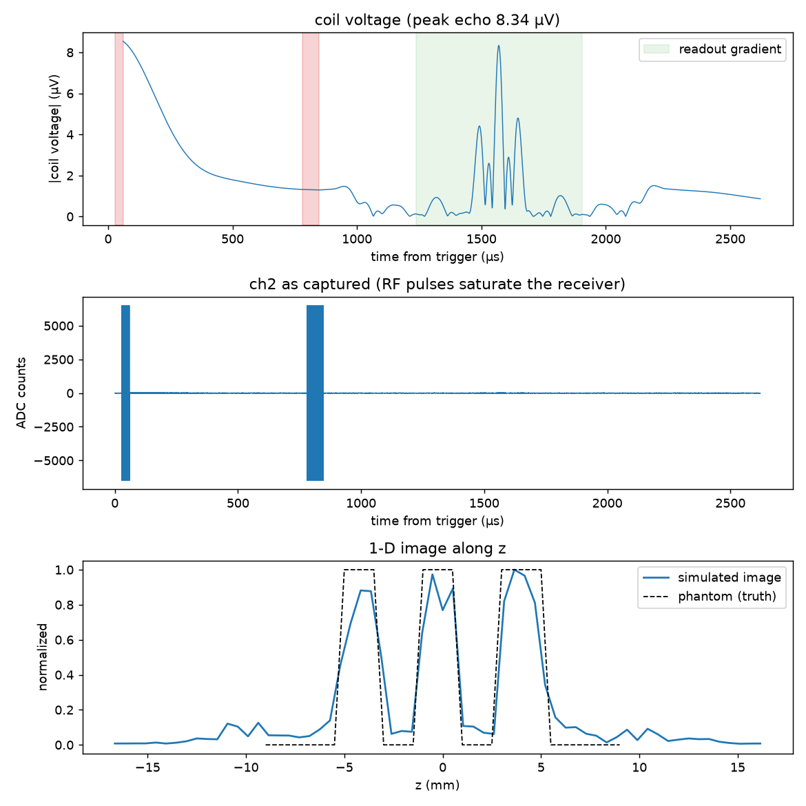
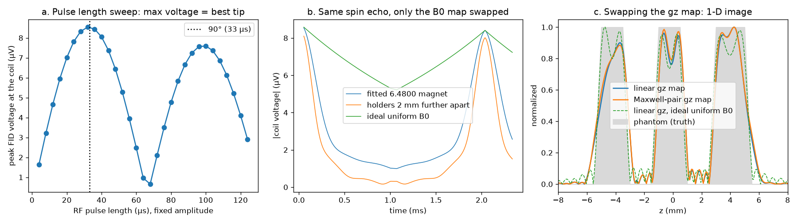

# sim6480: the 6.4800 tabletop MRI, simulated from field maps

Give it **field maps** (B0, the three gradient channels, the RF coil) and a **pulse sequence**. It returns the
**voltage on the receive coil**, the ADC counts and FPGA bytes the lab would capture, and the 1-D image the lab's
processing makes from them. The hardware enters only through the maps. Swap a map for a measured one, or for one
generated from a different magnet or coil, and nothing else changes. That makes it easy to compare strategies: a
higher peak echo voltage means the spins are better aligned, as in Irene's thesis.

```bash
pip install -r requirements.txt
python -m sim6480 run --plot shot.png                       # one shot of the default design
python -m sim6480 run design/examples/maxwell_gz.yaml       # the same shot with a coil-pair z gradient
python -m sim6480 run --set gradients.axis=y --set phantom.liquid=pure_water
python -m sim6480 numbers                                   # scaling: B0, M0, EMF per mm^3, noise, gain
python -m sim6480 export-maps maps/                         # the maps a shot uses, as files you can edit
python -m sim6480 jemris out/                               # the same shot as JEMRIS input, for the cluster
python tools/sweep_gap.py --shots                           # magnet holder spacing vs field spread and echo
python demo/demo.py                                         # maps + Pulseq sequences in, coil voltage out (~20 s)
python -m pytest tests -q
```



*Default design (Aubert-pair magnet), readout along z, three-slice phantom. Top: coil voltage, with RF pulses in red and the readout
gradient in green. Middle: ch2 counts as captured. Bottom: the image the lab's processing makes, against the
phantom.*

## Demo: maps and sequences in, voltage out

`demo/demo.py` runs the whole idea end to end:
1. It writes every field map to a plain `.npz` file (`demo/out/maps/`). From then on the simulator sees only
   those files.
2. It writes the pulse sequences as standard Pulseq files (`demo/out/seqs/`).
3. It reads out the coil voltage for each pair.



| strategy | what changes | result |
|---|---|---|
| a. RF pulse length sweep | the sequence only | peak FID voltage 8.54 µV at 32 µs, the true 90° (33 µs). Past 90° the voltage falls: the peak voltage is the alignment score |
| b. the same spin echo on three magnets | the B0 map only | the FID fades in 0.25 ms (fitted magnet), 0.16 ms (holders 2 mm further apart), > 0.5 ms (ideal). The echo comes back on all three: 8.41, 8.02, 8.41 µV |
| c. readout with two gradient coils | the gz map only | a linear map and a Maxwell pair give nearly the same image. With an ideal B0 the slots come out much sharper, so on this scanner the magnet limits the image, not the gradient coil |

To try your own: build a sequence with pypulseq (or write a `.seq`) and call
`simulate_sequence(design, seq)` in `sim6480/simulate.py`, or use `python -m sim6480 run --set sequence.file=my.seq`.
**Gradient units:** a gradient of 1e6 Hz/m in the sequence means drive 1 of that axis's gradient map. The map
decides what that is in real Hz/mm.

## What it does

**What is it imaging?** The real 3D-printed phantoms. Their STL files, from
[6480-pulse-sequence](https://github.com/MITMRI/6480-pulse-sequence), are voxelized at 0.5 mm where they sit in
the scanner and filled with a liquid from the design: doped water by default, or pure water or mineral oil. The
default is the three-slice phantom: three 2 mm slots, 4 mm apart, 10 mm deep, 853 mm³ of water.

**How does it simulate pulse sequences?** The sequence is the firmware's own spin echo:
- **Timing:** read from the Teensy firmware by `pulseseq.timeline`, which counts its GPIO writes. The pulses are
  90° at 27–60 µs and 180° at 780–848 µs; the gradient lobes run dephase, readout, rewind; the echo is at about
  1.58 ms.
- **Format:** written as a standard Pulseq `.seq` file. MRzero reads that file directly, and JEMRIS reads it after
  `tools/seq_to_jemris_xml.py` converts it.
- **Your own sequence:** any Pulseq sequence, via `simulate_sequence` or the design key `sequence.file`. This
  gives the coil voltage; the receive chain and lab processing assume the firmware's timing.

**What is the kernel?** [MRzero](https://github.com/MRsources/MRzero-Core) (MRzeroCore 1.3), a *phase
distribution graph* (PDG) simulator:
- **Per pulse:** each RF pulse splits each voxel's magnetization into a few states. Between pulses every state
  relaxes (T1, T2, T2′) and gains phase from the voxel's off-resonance and from the gradients.
- **Speed:** about 2 s per shot on a laptop CPU, so parameter sweeps are cheap.
- **Arbitrary gradient maps:** each voxel's gradient phase is set from the gradient field it actually sits in.
  Its encoding coordinate becomes γ̄·B_grad,∥(r) / 10⁶ Hz/m, so a nonlinear gradient map distorts the image the
  way the real coil would.
- **Cross-check:** for a high-fidelity Bloch-equation check, the same experiment exports to
  [JEMRIS](https://www.jemris.org) and runs on the cluster. See `../JEMRIS_VS_MRZERO.md` for why both.

**Inputs, concretely:**

| input | form | default |
|---|---|---|
| B0 map | vector field (T) on a grid, `.npz`/`.h5` | the 6.4800's **Aubert-pair magnet** (`design/maps/b0_aubert.npz`): 107.3 mT along z, −2.3 to +3.6 kHz across the phantom |
| gx, gy, gz maps | vector field (T) per unit of drive | linear, 3000 Hz/mm per drive; or coils by their dimensions (`loops:`, e.g. a **Maxwell / anti-Helmholtz pair**) |
| RF coil map | vector field (T per amp) | 20-turn solenoid on the 19 mm coil form, axis x |
| sequence | the firmware's timings, or a `.seq` | firmware spin echo, 128 × 1024 samples at 50 MS/s |
| phantom + liquid | STL + T1, T2, proton density | three-slice phantom, doped water (T1 0.2 s, T2 0.15 s) |
| receive chain | gains, noise, ADC | AFE5808A: LNA 24 dB + PGA 30 dB, 14-bit, 2 Vpp, 1 nV/√Hz |

**Outputs, concretely:**

| output | value for the default design |
|---|---|
| coil voltage vs time | complex baseband, V; peak echo **8.3 µV**; the FID decays in ~0.3 ms (magnet T2*) |
| noise at the coil | 3.2 µV rms in the 10 MHz bandwidth |
| ADC counts | about ±35 counts of echo on ch2 (8.3 µV × 54 dB ÷ 0.12 mV per count); RF pulses saturate |
| FPGA bytes | exactly what the laptop receives (6480-signal-processing's packing) |
| 1-D image | along the readout axis, 0.52 mm pixels: three slices for z, one block for y |

**Scale check.** Water at 107 mT and 22 °C has M0 = 3.5×10⁻⁴ A/m. With the coil's 1.05 mT/A, reciprocity gives
10.6 nV per mm³ of water tipped 90°. For the phantom's 853 mm³ that is about 9 µV. The full simulation gives
8.3 µV, a little less because of T2′ and the coil's falloff (`python -m sim6480 numbers`).

## Built on MRzero and JEMRIS

sim6480 doesn't write its own Bloch solver. It uses two open-source simulators and adds what they need to stand in
for the 6.4800.

**What each one provides, unchanged:**

| | [MRzero](https://github.com/MRsources/MRzero-Core) (MRzeroCore 1.3) | [JEMRIS](https://www.jemris.org) (this repository) |
|---|---|---|
| role here | the kernel every shot runs on | an optional high-fidelity check, run on the cluster |
| method | phase distribution graphs: states per RF pulse, relaxation and phase between pulses | Bloch equations integrated per spin (CVODE) |
| speed | ~2 s per shot on a laptop | minutes to hours |
| takes | a Pulseq `.seq` and a voxel phantom (PD, T1, T2, T2′, off-resonance in Hz, B1, coil sensitivity) | XML sequence, `sample.h5` phantom, coil XML |
| gives | the signal in arbitrary units | the signal in arbitrary units |

Neither knows about the 6.4800's magnet, coils, firmware, receiver or processing. Both expect linear gradients
and give unitless signal.

**What sim6480 adds:**

- **Field maps as the only hardware input.** Any vector B0, gradient and RF-coil map, from a file or generated,
  becomes what the kernel takes for each voxel: off-resonance from |B0|, a flip-angle map and receive sensitivity
  from the coil's field across B0.
- **Nonlinear gradients in MRzero.** MRzero only does linear gradients, so each voxel is placed at its *encoding*
  coordinate, γ̄·B_grad,∥(r) / 10⁶ Hz/m, instead of its true position. A nonlinear gradient map then distorts the
  image the way the real coil would, with no change to MRzero.
- **Volts at the coil.** The unitless signal becomes volts by reciprocity, using the water's Curie-law
  magnetization at the design's B0 and the coil map's field per amp. The scale check above confirms it.
- **The 6.4800's own sequence.** The spin echo's timing is read from the Teensy firmware (its GPIO writes) and
  written as Pulseq. The RF phase follows the free-running square wave. ADC samples before the first RF pulse
  are skipped, because MRzero drops them.
- **The rest of the signal chain.** RF at the Larmor frequency, coil noise, AFE5808A gains, receiver saturation
  during RF, the 14-bit ADC and the FPGA's byte packing, then the lab's own processing code for the 1-D image.
- **The real parts.** Phantoms voxelized from their STL files. The magnet is modelled from the holder CAD as an
  Aubert pair (a dipole sum over 200 bar magnets). Coils come from Biot–Savart current loops. Each generator is
  checked against a closed form in `tests/`.
- **One design for both kernels.** `python -m sim6480 jemris` writes the same shot as JEMRIS input: the B0 map
  as JEMRIS's off-resonance, the sequence through this repository's Pulseq-to-XML converter
  (`tools/seq_to_jemris_xml.py`), and an `export.json` with the volts scale and what JEMRIS gets only
  approximately (linear gradients, uniform coils).
- **A strategy loop.** Design files, single-value overrides, any Pulseq sequence (`simulate_sequence`), the
  holder-spacing sweep and the demo, all scored by coil voltage.

## Field maps: the only way hardware enters

The simulator never sees "a magnet" or "a gradient coil". It sees what they produce:

```yaml
fields:
  b0:   {file: maps/b0.npz}        # or rings: [...] / offset_hz + linear + quadratic
  gz:   {file: maps/gz.npz}        # or loops: [...] + amps_per_drive / hz_per_mm_per_drive
  coil: {file: maps/coil.npz}      # or loops: [...] / solenoid: {...}
```

**File format.** A map file has `x_mm, y_mm, z_mm` (1-D grid axes) and either `Bx, By, Bz` (vector field) or `B`
(a scalar field along `b0_direction`), in tesla. Gradient maps are per unit of drive; the coil map is per amp.
`python -m sim6480 export-maps maps/` writes the current maps in this format, so you can start from them. Relative
paths are read from `design/`.

**What each map becomes:**

| map | becomes | per voxel |
|---|---|---|
| B0 | off-resonance | γ̄·\|B0(r)\| − f_rf |
| gradient maps | encoding | the field component along the local B0 |
| coil (transmit) | flip-angle map | \|B1⊥(r)\| relative to the centre |
| coil (receive) | sensitivity | \|B1⊥(r)\| in T/A; volts by reciprocity, V = ω·(B1/I)·M0·V_voxel |

**Built-in generators.** Each is checked against a closed form in `tests/`:
- **Permanent-magnet rings and bar magnets, `generated_rings`:** axial or radial magnetization (dipole sum over
  the magnet volume); `count` + `width_mm` make a ring of discrete bars. `match_larmor: true` scales the map so its
  centre sits at `magnet.larmor_hz`.
- **Current loops, `generated_loops`:** coil pairs and solenoids, via Biot–Savart with elliptic integrals.
  `design/examples/maxwell_gz.yaml` is an anti-Helmholtz z-gradient pair.

> The coil dimensions in `maxwell_gz.yaml` are **placeholders**: the gradient coils aren't in the CAD.

## The magnet

The 6.4800's magnet is an **Aubert pair**: two printed holders (`mri25MagHolder.stl`) facing each other on the z
axis, with the RF and gradient coils between them (reference photos in the 6.4800 design files).
`design/examples/aubert_6480.yaml` describes it, and `tools/make_b0_map.py` turns that into
`design/maps/b0_aubert.npz`, the default B0.

| what | value | from |
|---|---|---|
| magnets per holder | 100 bars, in two rings of 50 | CAD |
| inner ring | radius 40.9–51.7 mm, 3.2 mm wide | CAD |
| outer ring | radius 61.8–71.8 mm, 5.8 mm wide, offset half a slot | CAD |
| bar length (along z) | ~30 mm, through the holder and out of its outer face | photos |
| magnetization | radially in in one holder, out in the other | fit: of axial, radial and mixed layouts, only this reaches ~100 mT |
| gap between the holders' slot layers | 74 mm, where the field is flattest | fit (the `mri25Cam*` spacers, 3.28–4.22 mm, look like how the gap is trimmed) |
| grade | Br 1.38 T (N48–N50) | fit: gives 107.3 mT |
| polarity | B0 along +z | convention: reversing the magnet mirrors images, as it would on the bench |

This matches what the 6.4800 staff described: ~100 mT from 200 magnets in two 3D-printed hub-and-spoke holders,
with an adjustable separation that sets the z inhomogeneity. Patrick McDaniel's work is the reference they gave for
B-field variation and magnet layout.

**Result:** about 5 kHz (1000 ppm) of B0 variation across the 10 mm phantom. The FID now dies in ~0.3 ms (T2*),
while the spin echo still refocuses. A gaussmeter map of the bore, or a field-mapping scan, would replace the
fitted values: save it in the map format and point `fields.b0.file` at it.

## Testing a strategy: the holder spacing

The holder spacing is the magnet's tuning knob. `tools/sweep_gap.py` moves both holders symmetrically, retunes
the RF to each new centre field, and runs a shot each time (numbers below: three-slice phantom, no noise):

| spacing (mm) | B0 (mT) | spread over the water | peak echo (µV) |
|---|---|---|---|
| 88 (−8) | 116.9 | 42.7 kHz (8600 ppm) | 8.11 |
| 92 (−4) | 112.1 | 20.7 kHz | 8.51 |
| 94 (−2) | 109.6 | 11.2 kHz | 8.53 |
| **96 (fitted)** | **107.2** | **5.9 kHz (1300 ppm)** | 8.33 |
| 98 (+2) | 104.7 | 6.8 kHz | 7.92 |
| 100 (+4) | 102.3 | 12.6 kHz | 7.40 |
| 104 (+8) | 97.4 | 24.6 kHz | 6.31 |

Two things to read from it:
- **The spacing is touchy.** 2 mm either way roughly doubles the field spread. The flattest spacing gives about
  6 kHz, which is already a fifth of the 30 kHz imaging bandwidth, so B0 variation shows up as image distortion.
- **The peak echo isn't only an alignment score.** A spin echo refocuses static B0 variation, and the signal grows
  as B0² (magnetization × frequency). So a closer, stronger, *less* uniform magnet can give a slightly bigger
  echo. To score homogeneity, use the spread column, the FID's decay (T2*), or the image's sharpness.

## Changing the design

`design/default.yaml` holds every number, each tagged with where it came from:
- **[firmware]** the Teensy firmware
- **[fpga]** the FPGA driver
- **[afe]** the AFE5808A settings the firmware programs
- **[schematic]** the main board, newMRI_26_08A
- **[stl]** the 3D-printed parts
- **[guess]** not measured yet

Three ways to change it:
1. Edit the file.
2. Layer a file over it: `python -m sim6480 run my_magnet.yaml`. It only needs the keys it changes.
3. Override one key: `--set key.path=value`.

Unknown keys are an error, so typos don't pass silently.

## How it fits together

```
design/default.yaml (+ your layers)
  │
  ├─ fieldmaps.py   B0, gx, gy, gz, coil maps (files or generated) → per-voxel off-resonance, encoding, B1, sensitivity
  ├─ phantom.py     STL phantom → voxels (6480-pulse-sequence)
  ├─ sequence.py    firmware timings → Pulseq .seq (6480-pulse-sequence)
  ├─ kernel_mrzero.py   MRzero PDG → coil voltage (V)
  ├─ receive.py     RF at 4.567 MHz, noise, AFE gain, RF saturation, 14-bit ADC → FPGA words → bytes
  ├─ process.py     the lab's own processing: unpack, downconvert, echo row, image (6480-signal-processing)
  └─ jemris_export.py   the same experiment as JEMRIS files (sample.h5, sequence.xml, simu.xml, coils)
```

## Known limits

- **One shot, 1-D images.** The firmware's spin echo with a single readout gradient. Any Pulseq sequence can be
  given instead (`simulate_sequence`, coil voltage only); phase encoding for 2-D works in principle but hasn't
  been tried here.
- **B0 direction.** MRzero assumes one common B0 direction. The maps' local direction sets each voxel's
  frequency and gradient component, but a field that rotates a lot across the sample is beyond the PDG model.
  JEMRIS handles that better.
- **JEMRIS export.**
  - Gradients are made linear (each map's centre slope); `export.json` reports the worst position error.
  - Coils are uniform.
  - Reading JEMRIS's signal back (`load_signal`) hasn't been run against a real cluster output yet.
- **Not measured yet** (the [guess] and [fit] values):
  - the magnet's bar length, grade, gap and polarity (fitted, not measured)
  - gradient-coil geometry: not in the CAD. The gradients are linear at 3000 Hz/mm, from the staff's 30 kHz
    imaging bandwidth across the 10 mm phantom; their coils are opposed pairs, linear in y and z, up to 2 A
  - RF coil resistance; coil turns are taken as 20 from the simulation team notes
  - preamp gain, noise density, T2′ (the ADC's 2 Vpp full scale is fixed by the AFE5808A)
  - whether the firmware's register 0x3B setting (0x3B00C4) turns on 24 dB of attenuation: its own comments say
    it does. `receive.digital_db` is 0 until a capture's noise floor shows which
- **Orientation.** With `gradients.sign: -1` (the firmware's default) the image matches the phantom's
  orientation. Flipping the sign mirrors it, as it would on the bench.
